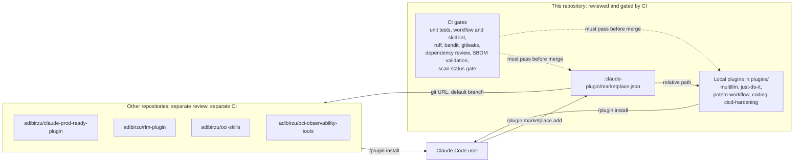

# adibirzu-plugins

Claude Code plugin marketplace by [adibirzu](https://github.com/adibirzu) for production engineering, gated delivery workflows, CI/CD hardening, multi-model routing, and OCI cloud operations.

## Plugins

| Plugin | Description | Version |
|--------|-------------|---------|
| [prod-ready](https://github.com/adibirzu/claude-prod-ready-plugin) | Pre-production security audit, dependency hardening, CI/CD validation, and Docker readiness checks | 1.0.0 |
| [rlm](https://github.com/adibirzu/rlm-plugin) | Budgeted recursive analysis with evidence ledgers and selective verification | 4.0.0 |
| [multillm](plugins/multillm) | Multi-LLM gateway with model discovery, session tracking, usage controls, fusion, and cross-LLM memory. Fails the skill scan, see [scan status](#plugin-scan-status) | 0.9.0 |
| [oci-administrator](https://github.com/adibirzu/oci-skills) | Safety-first OCI administration, Terraform, platform engineering, storage, disaster recovery, Bastion, database, and landing-zone workflows | 2.0.0-rc.3 |
| [just-do-it](plugins/just-do-it) | Portable PRD delivery and clean least-privilege agent-team generation across major coding harnesses | 1.5.0 |
| [oci-observability-tools](https://github.com/adibirzu/oci-observability-tools) | Offline OCI Observability and Management skills and validators | 0.1.0 |
| [poteto-workflow](plugins/poteto-workflow) | Interrogate, arena, swarm and show-me-your-work under seven hard crew gates | 1.0.0 |
| [coding-cicd-hardening](plugins/coding-cicd-hardening) | Secure coding and CI/CD baseline with a workflow linter and an SBOM generator | 1.0.0 |

## Installation

Add this marketplace to Claude Code:

```bash
/plugin marketplace add adibirzu/adibirzu-plugins
```

Then install individual plugins:

```bash
/plugin install prod-ready@adibirzu-plugins
/plugin install rlm@adibirzu-plugins
/plugin install multillm@adibirzu-plugins
/plugin install oci-administrator@adibirzu-plugins
/plugin install just-do-it@adibirzu-plugins
/plugin install oci-observability-tools@adibirzu-plugins
/plugin install poteto-workflow@adibirzu-plugins
/plugin install coding-cicd-hardening@adibirzu-plugins
```

Refresh the catalog and an installed plugin after a release:

```text
/plugin marketplace update adibirzu-plugins
/plugin update oci-administrator@adibirzu-plugins
/plugin update just-do-it@adibirzu-plugins
/reload-plugins
```

## Plugin scan status

Every local plugin is scanned with SkillSpector 2.12.0, `--no-llm`, as a whole bundle. The verdict is published here so you can decide before you install. Scanned on 2026-11-20.

| Plugin | Verdict | Score | Findings | Note |
|---|---|---|---|---|
| `poteto-workflow` | SAFE | 0 | 0 | Instructions only, no hooks or scripts |
| `coding-cicd-hardening` | SAFE | 0 | 0 | Two standard-library scripts that read files and write SBOMs |
| `just-do-it` | CAUTION | 44 | 5 | Writes agent team configurations, so it touches agent config directories |
| `multillm` | DO_NOT_INSTALL | 100 | 37 | A `SessionStart` hook installs packages with pip and starts a background gateway that reads provider API keys |

**`multillm` fails the scan.** Read [SECURITY.md](SECURITY.md#known-scan-findings) before you install it. It stays listed for existing users, with a warning in its catalog description.

The rule: a plugin with a DO_NOT_INSTALL verdict may only be listed with that warning in its description, and a new plugin is not accepted with that verdict at all. `tests/test_marketplace.py` enforces the first half. Remote plugins are scanned by their own repositories, not here.

Reproduce a verdict:

```bash
skillspector scan plugins/<name> --no-llm --recursive
```

## Current Marketplace Architecture

The marketplace is one manifest, `.claude-plugin/marketplace.json`, that points at two kinds of plugin source. Local plugins live in this repository and pass its CI. Remote plugins live in their own repositories and are fetched by Claude Code at install time.



### Trust boundaries

| Boundary | What crosses it | Control |
|---|---|---|
| Contributor to this repository | Pull requests | CI with a read-only token, no `pull_request_target`, secret scan on every commit, owner approval to merge |
| This repository to a remote plugin | A git URL in the manifest | The URL must be a public `adibirzu` repository with a valid `.claude-plugin/plugin.json`. Its content is not reviewed here and is not pinned to a commit, so a remote plugin is only as trustworthy as its own repository |
| CI to third-party actions and tools | Code that runs with the job token | Actions pinned to 40-character commit SHAs, tools installed with pip hash checking, gitleaks verified by checksum, default token permissions empty |
| Marketplace to your machine | Skills, commands, hooks and scripts that run with your agent's access | Read a plugin before you install it and check its row in the scan status table. `multillm` ships hooks that install packages and start a local gateway, and fails the scan |

The manifest is the only thing Claude Code reads from this repository to build the catalog. Nothing outside `.claude-plugin/` and `plugins/` is installed by any plugin, and only catalog content is allowed at the top level of this repository.

### Living-doc rule

This section is part of the change, not an afterthought. Any pull request that adds, removes or moves a plugin, changes a plugin source, changes a trust boundary, or changes a CI gate updates the diagram and the tables above in the same pull request, and rescans any plugin it touches. `tests/test_marketplace.py` fails when the plugin table, the scan status table and the manifest disagree.

## Version sync

The version shown here for a remote plugin is catalog metadata. The version you get on install is whatever the remote repository's default branch holds.

| Plugin | Catalog version | Source of truth |
|---|---|---|
| rlm | 4.0.0 | `adibirzu/rlm-plugin`, `.claude-plugin/plugin.json` on `main` |
| prod-ready | 1.0.0 | `adibirzu/claude-prod-ready-plugin` |
| oci-administrator | 2.0.0-rc.3 | `adibirzu/oci-skills` |
| oci-observability-tools | 0.1.0 | `adibirzu/oci-observability-tools` |

The `rlm` entry is paired with the `adibirzu/rlm-plugin` 4.0.0 release. Merge the catalog bump only after 4.0.0 is on that repository's `main`, otherwise the catalog advertises a version users cannot install yet. Bump a remote plugin's catalog version in the same week its repository releases, and verify it with the command in [CONTRIBUTING.md](CONTRIBUTING.md).

Local plugin versions are enforced: the manifest, each plugin's `.claude-plugin/plugin.json` and `.codex-plugin/plugin.json`, and the table above must agree or the tests fail.

## Development

```bash
python3 -m unittest discover -s tests -v
python3 plugins/coding-cicd-hardening/scripts/check_workflows.py .
```

Both need only the Python standard library. See [CONTRIBUTING.md](CONTRIBUTING.md) for the pull request checklist and [SECURITY.md](SECURITY.md) to report a vulnerability.

## MultiLLM Notes

The `multillm` plugin now includes:

- Claude and Codex usage guides for the same gateway and MCP toolset
- richer usage math in the dashboard summaries, including per-request and per-session calculations
- hourly usage checks in addition to 24h and 7d summaries
- a portable `MULTILLM_HOME` setup so multiple devices can point at one synced data directory
- built-in orchestration patterns so Claude/Codex can pull in council, second-opinion, and context-sharing help more consistently

For multi-device usage consolidation, set `MULTILLM_HOME` to the same synced directory on each device before starting the gateway:

```bash
export MULTILLM_HOME="$HOME/Library/Mobile Documents/com~apple~CloudDocs/.multillm"
```

## License

MIT. See [LICENSE](LICENSE). Remote plugins are licensed by their own repositories.
